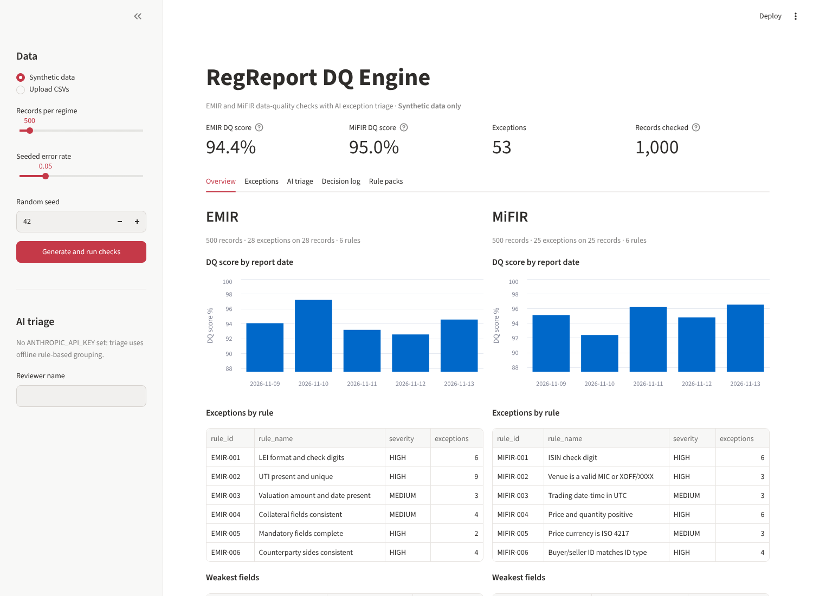
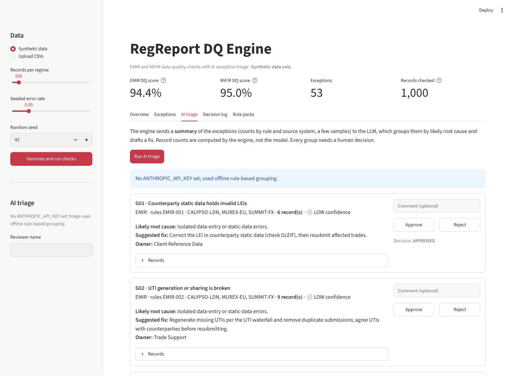

# RegReport DQ Engine

> **Synthetic data only.** Every trade, entity, LEI and ISIN in this repo is generated by code. No real client, firm or employer data, code or mappings are used.

A Python tool that checks **EMIR** derivative reports and **MiFIR** transaction reports for data-quality errors, scores the results, and uses an **LLM (Claude)** to group exceptions by likely root cause and draft fixes. A person approves or rejects every suggestion.



## Why

Regulatory reporting teams spend a lot of time finding and chasing the same kinds of breaks: invalid LEIs, duplicate UTIs, missing valuations, wrong venue codes, timestamps not in UTC. The checks themselves are well defined. The slow part is working out *why* a batch of exceptions happened and who should fix it. This project automates the checks and uses AI to speed up the triage.

## How it works

A six-stage pipeline. Each stage is its own module, so a new regime only needs a new rule pack.

| Stage | Module | What it does |
|---|---|---|
| 1. Ingest | `dqengine/ingest.py` | Reads report CSVs as text, so values are checked exactly as reported |
| 2. Validate | `dqengine/engine.py`, `config/rules/*.yaml` | Runs a rule pack. Each rule has an ID, fields, check, severity and plain-English message |
| 3. Reference checks | `dqengine/identifiers.py`, `dqengine/reference.py` | LEI check digits (ISO 17442), ISIN check digit (ISO 6166), MIC (ISO 10383), currency (ISO 4217) |
| 4. Score | `dqengine/scoring.py` | Exceptions table plus DQ score overall, per field and per report date |
| 5. AI triage | `dqengine/triage.py`, `dqengine/decisions.py` | Claude groups exceptions by root cause and drafts fixes; human approve/reject with an audit log |
| 6. Report | `app.py`, `dqengine/report.py` | Streamlit dashboard and a daily Excel exceptions report |

### Rule packs

Rules live in readable YAML, so an analyst can review or add a rule without touching Python:

```yaml
- id: MIFIR-002
  name: Venue is a valid MIC or XOFF/XXXX
  check: in_reference
  fields: [venue]
  params: {list: mic, also_allowed: [XOFF, XXXX]}
  severity: HIGH
  message: Venue is not a known ISO 10383 MIC...
```

**EMIR (6 rules):** LEI format and check digits · UTI present and unique · valuation amount and date present · collateral portfolio fields consistent · mandatory fields complete · counterparty sides consistent

**MiFIR (6 rules):** ISIN check digit · venue is a valid MIC or XOFF/XXXX · trading date-time in UTC · price and quantity positive · ISO 4217 currency · buyer/seller ID matches its type (LEI / CONCAT / NIDN / CCPT)

Field names are a simplified, readable subset of the EMIR Refit and MiFIR RTS 22 fields.

### AI triage, with guardrails



- Only a **summary** goes to the model: counts per rule, split by source system, plus a few sample values. Not the full file.
- The model returns JSON groups (title, rules, source systems, root cause, fix, owner, confidence).
- **Record membership is computed by the engine** from the rules and systems the model names, so counts are exact and record IDs are never invented. Anything the model doesn't cover lands in a "needs manual review" group.
- Every group needs a human **Approve / Reject**, logged with reviewer, time and comment in `data/output/decisions_log.csv`.
- No API key? It falls back to an offline rule-based grouping, so the demo always runs.

## Results on the synthetic data

The generator seeds known errors (default 5%) and writes a ground-truth file, so detection can be measured rather than claimed. Default run (500 EMIR trades + 500 MiFIR transactions, seed 42):

| | Records | Rules | Seeded error records | Caught | False positives |
|---|---|---|---|---|---|
| EMIR | 500 | 6 | 28 | 28 | 0 |
| MiFIR | 500 | 6 | 25 | 25 | 0 |

These numbers show the rules work as designed on errors the generator knows about. Real data would be messier.

## Run it

```bash
git clone https://github.com/<your-username>/regreport-dq-engine.git
cd regreport-dq-engine
python -m venv .venv
source .venv/bin/activate          # Windows: .venv\Scripts\activate
pip install -r requirements.txt

# Optional: enable Claude triage
cp .env.example .env               # then add your ANTHROPIC_API_KEY

streamlit run app.py               # dashboard
python run_pipeline.py --triage    # or the command-line version
pytest                             # 18 tests
```

Other options:

```bash
python -m synthetic.generate --n 2000 --error-rate 0.08 --seed 7   # bigger dataset
python run_pipeline.py --emir my_emir.csv --mifir my_mifir.csv     # your own CSVs (same columns)
```

Outputs land in `data/output/`: `exceptions.csv`, per-field scores, `triage_groups.csv`, `decisions_log.csv` and `dq_exceptions_report_YYYYMMDD.xlsx`.

### Reference data

Small starter lists ship in `data/reference/` so the demo runs offline. For full coverage, download the official ISO 10383 MIC list (save as `ISO10383_MIC.csv`) and the ISO 4217 list (save as `list_one.csv`) into the same folder; they're picked up automatically. `reference.gleif_lookup()` can check an LEI against the public GLEIF API (synthetic LEIs won't be found there, by design).

## Project layout

```
config/rules/        EMIR and MiFIR rule packs (YAML)
dqengine/            engine, checks, identifiers, scoring, triage, decisions, report
synthetic/           synthetic data generator with seeded errors
data/input/          generated report files and ground truth
data/reference/      MIC and currency lists
data/output/         exceptions, scores, triage, decision log, Excel report
app.py               Streamlit dashboard
run_pipeline.py      command-line runner
tests/               pytest suite
```

## Roadmap

- EMIR Refit ISO 20022 XML ingestion
- Live GLEIF LEI status checks (lapsed / retired LEIs)
- Front-office vs. regulatory report reconciliation
- ESMA Q&A retrieval so triage can cite guidance
- Scheduled daily runs (n8n)

## Sources

Public standards and guidance only: ESMA EMIR and MiFIR validation rules and Q&As, ISO 17442 (LEI), ISO 6166 (ISIN), ISO 10383 (MIC), ISO 4217 (currencies), GLEIF public API.

## Author

Milind Ligam · [LinkedIn](https://www.linkedin.com/in/milind-ligam-8b8a052b5)
